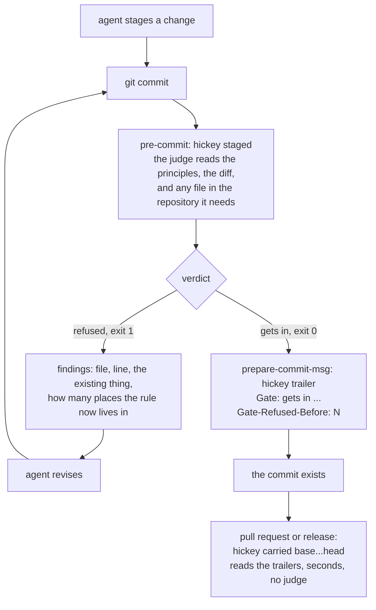

<p align="center">
  
</p>

<h1 align="center">hickey</h1>

<p align="center"><strong>Make your coding agent write maintainable code.</strong></p>

<p align="center">
  <a href="#quick-start">Quick start</a> &nbsp;·&nbsp;
  <a href="#the-loop">How it works</a> &nbsp;·&nbsp;
  <a href="./PRINCIPLES.md">Principles</a> &nbsp;·&nbsp;
  <a href="https://www.npmjs.com/package/hickey">npm</a>
</p>

<p align="center">
  <a href="https://www.npmjs.com/package/hickey"></a>
  <a href="./LICENSE"></a>
  
</p>

```sh
npm install --save-dev hickey lefthook
npx lefthook install
```

> Simplicity is hard work. But, there's a huge payoff. The person who has a genuinely simpler system - a system made out of genuinely simple parts, is going to be able to affect the greatest change with the least work.
>
> He's going to kick your ass. He's gonna spend more time simplifying things up front and in the long haul he's gonna wipe the plate with you because he'll have that ability to change things when you're struggling to push elephants around.
>
> <p align="right">Rich Hickey, <em>Simplicity Matters</em></p>

hickey is a commit gate. Before a commit exists, a judge reads your whole repository and asks one question: **does the system make more sense with this change in it, or less?**

If less, the commit is refused with a precise instruction. Your agent revises and commits again. When it gets in, the commit carries the verdict and the number of rounds it took.

## Highlights

- **Judges the whole, not the diff.** The judge reads any file it needs. A change is compared as a system: the codebase as it is against the codebase with the change in it.
- **Refuses with an instruction.** Every finding names the file, the line, the existing thing it relates to, and how many places a rule now lives in.
- **Closes the loop around your agent.** A refusal exits non-zero, so the commit does not happen until a change passes. Refuse, revise, judge again, in.
- **Records everything in git.** The verdict and the refusal count are trailers on the commit, written by `git interpret-trailers`. A pull request is checked in seconds with no judge at all.
- **Your principles, or ours.** Ships with the simplicity principles of Rich Hickey's talks, written for a judge. Point it at your own document and it judges as your tech lead would.
- **Runs on your machine.** The judge is your own coding agent, isolated, read-only, with nothing of yours loaded. No service, no key in CI.

## Contents

1. [Example](#example)
2. [Why this exists](#why-this-exists)
3. [The loop](#the-loop)
4. [Quick start](#quick-start)
5. [Commands](#commands)
6. [What the judge asks](#what-the-judge-asks)
7. [Bring your own tech lead](#bring-your-own-tech-lead)
8. [Configuration](#configuration)
9. [Cost](#cost)
10. [FAQ](#faq)
11. [Roadmap](#roadmap)

## Example

The setup: a small app with one entity, `User`, read from a line of CSV by hand in `src/users.ts`. You ask your agent to add `Order`. It writes `src/orders.ts` the same way: split the line, pick the fields. Clean code, good names, a reviewer would approve it. The agent commits.

```
$ git commit -m "add an order reader"

The whole today
  One entity, User, whose reader splits a line on commas by hand. There is no
  record abstraction and no CSV dependency.

The whole with this change
  Two files that each read a comma-separated line by hand, with the same
  split-and-destructure shape, differing only in the column names and one
  Number() coercion. The rule for how a line is split now lives in two places,
  and the third entity will be a third copy.

Findings
   src/orders.ts:2 (existing: readUser in src/users.ts): readOrder is a
   parameterised copy of readUser; the right form is one schema-driven row
   reader that both files compose.
   src/orders.ts:3 (existing: line splitting rule) (places: 2): A change to how
   a line is tokenised must be made in src/users.ts:3 and src/orders.ts:3.

Refused: The change turns one hand-rolled CSV reader into two copies of the
same shape; replace both with a single column-table-driven record reader that
users.ts and orders.ts each compose.
```

Your agent reads that, writes the one reader, commits again.

```
Gets in: Reading a comma-separated record now has one owner in record.ts and
each entity is a column table composing it, so the next change to the format
touches one line instead of one file per entity.
```

The commit carries both verdicts.

```
$ git log -1 --format=%B
add an order reader

Gate: gets in. Reading a comma-separated record now has one owner in record.ts ...
Gate-Refused-Before: 1 refusal on the way to this shape. Last: The change turns one hand-rolled CSV reader into two copies ...
```

That transcript is real, trimmed for length. Two rounds: 47 seconds to the refusal, 59 to the commit that got in. Harder changes take more rounds, and the count rides on the commit.

Duplication is the easiest of the judge's eight questions to show. Most refusals are about where a concern lives, not copies.

## Why this exists

**Simple is not easy.** In Rich Hickey's distinction, simple means un-braided: one concern, one role, one lifetime per construct. Easy means near at hand. A change can be easy and make the system more complex. With coding agents, it usually does.

**Agent-written code is locally consistent.** Clean in its file. Well named. Tests green. Reviewer happy. And locally consistent is exactly how complexity hides, because the agent reasoned from the task in front of it and landed an aspect wherever it happened to be working:

- a handler bundle in a module that does eight other things
- a conditional chain where a table belongs
- a parser moved into the protocol file because both sides already imported it
- a helper that hides a braid instead of naming a responsibility
- the thirty-sixth slightly different implementation of a thing that exists

**Every check you have passes it.**

| check | what it sees | what it misses |
|---|---|---|
| diff review | the change | the system it lands in |
| type checker, linter | a rule against a line | where a concern belongs |
| clone detector | copies | a function rewritten with a new name, and everything else on this list |
| tests | the task | whether the next change is cheaper |

**The braid grows faster than anyone can read it.** Six months later a one-line change touches a hundred places and you are pushing elephants around. An application that works but whose code is braided is not a lesser success. It is damage, and the cost lands on whoever has to change it next.

**hickey asks what a tech lead who holds the whole system in their head would ask**, over the whole change, by reading the repository. Then it gives one verdict as a comparison, not a count of findings. A correct capability that leaves the whole no more sensible does not get in. A change that makes the whole make more sense gets in, even when it is longer, because the next change will be cheaper.

## The loop

A commit gate is a loop, and the hook is what makes it one.



- The agent's goal is a commit.
- A refusal exits non-zero. The commit does not happen. The goal stands unmet.
- hickey is the loop's condition, the agent is its body, and "gets in" is the exit.
- The only other exit is `git commit --no-verify`, recorded on the commit as the override it is.

Each round costs about a minute. Each round the verdict compares the whole system again, so the agent is not patching the last finding. It is converging on a shape the whole makes sense with.

The trailers are the record of the convergence. `Gate-Refused-Before: 3` means the shape took four rounds, and the last refusal's reason is right there for the reviewer.

## Quick start

```sh
npm install --save-dev hickey lefthook
npx lefthook install
```

The second command matters. npm no longer runs a dependency's install scripts, so lefthook does not install its hooks on its own. hickey warns you if it sees a `lefthook.yml` naming it with no hook installed.

`lefthook.yml` at the repository root:

```yaml
output: [execution_out]
pre-commit:
  commands:
    hickey:
      run: npx hickey staged
prepare-commit-msg:
  commands:
    hickey:
      run: npx hickey trailer {1} {2}
post-commit:
  commands:
    hickey:
      run: npx hickey committed
```

That is the whole setup. No config file is required.

The judge needs [Claude Code](https://docs.claude.com/en/docs/claude-code) installed and signed in. The minimum version is declared in the package manifest and checked before judging.

## Commands

```sh
hickey staged                      # what is staged, as it would be committed
hickey uncommitted                 # everything uncommitted, against the last commit
hickey range origin/main...HEAD    # a branch, judged whole
hickey carried origin/main...HEAD  # every commit carries a verdict: for a pull request or a release
hickey staged --full               # the judge's full answer to each question
```

| exit | meaning |
|---|---|
| `0` | gets in |
| `1` | refused |
| `2` | no verdict could be reached, or usage |

`git commit --no-verify` is the committer's explicit acceptance of a refusal, and the commit says so. Nothing else bypasses the gate.

## What the judge asks

Eight questions, in order, over the whole change.

1. **What does it do?** In one sentence. If one sentence cannot hold it, that is the first finding.
2. **What aspect does it address, and who else touches that aspect?** Is the change placed where those components meet, or where this task happened to be working?
3. **Does something like this already exist?** A composition of it, an extension at its owning boundary, or a variation beside it? Only the first two are acceptable.
4. **How many places does one rule now live in?** One is an abstraction. Several is the braid beginning.
5. **Does the file still read as its name?**
6. **Would a developer reading this as the reference respect it?**
7. **Is the structure declarative?** Data and tables, or control flow a reader must execute in their head?
8. **Did it meet the letter of a principle while defeating its intent?** A copy parameterised instead of composed. A rename in place of a redesign. A helper that hides a braid.

Then the verdict, as a comparison of the codebase with and without the change.

The full document is [`PRINCIPLES.md`](./PRINCIPLES.md): the values with their reasons, the questions, judgments to calibrate against, and what does not count as evidence.

## Bring your own tech lead

The shipped principles are a starting point. The document that judges best is yours: your tech lead's rulings, in the form `PRINCIPLES.md` shows.

```json
{
  "principles": "docs/PRINCIPLES.md"
}
```

Put that in `hickey.config.json` and every commit is judged against your document.

## Configuration

`hickey.config.json` at the repository root. Every field is optional.

| field | values | default | what it does |
|---|---|---|---|
| `principles` | path from the repository root | the shipped `PRINCIPLES.md` | the document the judge reads |
| `judging` | `required`, `when-available` | `when-available` | `required`: no judge, no commit. `when-available`: a developer without the judge is not blocked, and hickey says the change was not judged |
| `kind` | `framework`, `tooling`, `harness` | `harness` | the one word the judge is told about what it is reading |
| `model` | a model id | the current Claude | the judge's model |
| `maxTurns` | integer | `30` | how many turns the judge may spend reading before it must answer |

## Cost

- A judgement is about a minute and reads your repository. It costs about what a minute of your coding agent costs.
- hickey prints the time and the dollars at the end of every verdict.
- Committing often? Run `hickey uncommitted` while you work and let the commit's run be the confirmation.
- Verdicts and the refusal journal live under your repository's git directory, never in the tree. Nothing is sent anywhere except to the agent you already use.

## FAQ

#### Is this a linter?

No. A linter checks a rule against a line. hickey compares two systems, the codebase with and without the change, and reads whatever files it needs to decide.

#### Is this a duplicate-code detector?

No. Duplication is one of eight questions, and the easiest to show in a README. Most refusals in practice are about placement, not copies.

#### Does it replace code review?

It replaces the part AI code review cannot do from where it stands.

A reviewer that sees only the diff is a hill-climber on a landscape it cannot see. It makes the change better by every measure available inside the change, then stops on top of a small hill: the local optimum, with no way of knowing a taller one exists elsewhere in the repository. Every suggestion is correct, and every one is about the diff.

That is the perfect blind spot for a coding agent. An agent optimises for a signal, the tests and the review. When the signal is diff-local, the cheapest way to satisfy it is a change that looks right on its own: a parameterised copy, a handler bundle where the task was working, a helper that hides the braid. That is reward hacking, and a diff-local review does not catch it. It rewards it.

Each diff makes sense alone. Over a few hundred of them the repository becomes a rich tapestry that no one fully understands, including the agents that wove it.

hickey moves the judgement to the whole: not the best version of this diff, but whether the system is simpler with it in. A tech lead who holds the codebase in their head does that by instinct. The judge does it by reading the codebase, every time.

#### What if I disagree with a refusal?

`git commit --no-verify`. The commit records that you overrode a refusal and why the judge refused, so the disagreement is on the record for the reviewer.

#### Can my agent read the verdict?

That is the point. The verdict is structured, and the findings name the file, the line, the existing thing and the count. Let the agent run `git commit` and read the refusal itself.

#### Does it need Claude Code?

Today, yes. A `command` judge that hands the principles and the change to any agent CLI and reads the verdict back is next.

#### Will it slow me down?

A minute per commit, and a minute less per review. The time and cost are printed on every verdict, so measure it on your repository.

#### Is this affiliated with Rich Hickey?

No. The shipped principles are the ideas of his talks Simple Made Easy and Simplicity Matters, in our words, as we apply them to reviewing a change. The project is not affiliated with or endorsed by him.

## Roadmap

- **Any agent as the judge.** A configured command hickey runs with the principles and the change, reading the verdict from its output. Codex, Gemini, whatever is on your machine.
- **A principles scaffold.** A starting document for a team to write their own tech lead's rulings into.
- **Generated files out of the delta.** Lockfiles cost dollars and tell the judge nothing.

## Developing

```sh
git clone https://github.com/lloyal-ai/hickey && cd hickey
npm install          # also installs the hooks: hickey gates its own commits
npm run build
npm test             # runs against a stand-in judge; Claude Code is never run by the tests
```

Every commit to this repository goes through hickey. Read the trailers in `git log` to see what the judge said about each one.

A release is a pushed tag `vX.Y.Z` that matches the version in `package.json`. The workflow checks the match, checks that every commit since the previous release carries the gate's record, publishes to npm with provenance, and opens the GitHub release.

## License

[MIT](./LICENSE)
